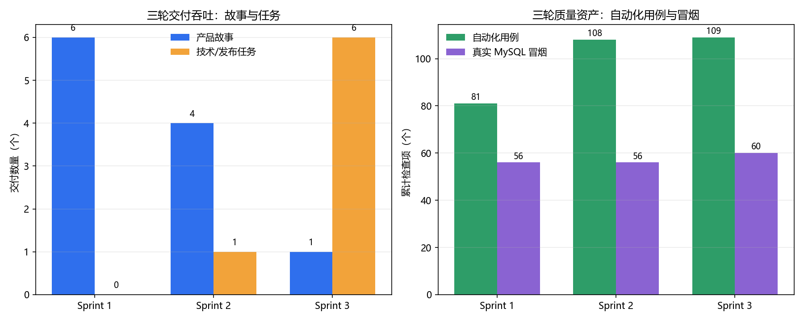
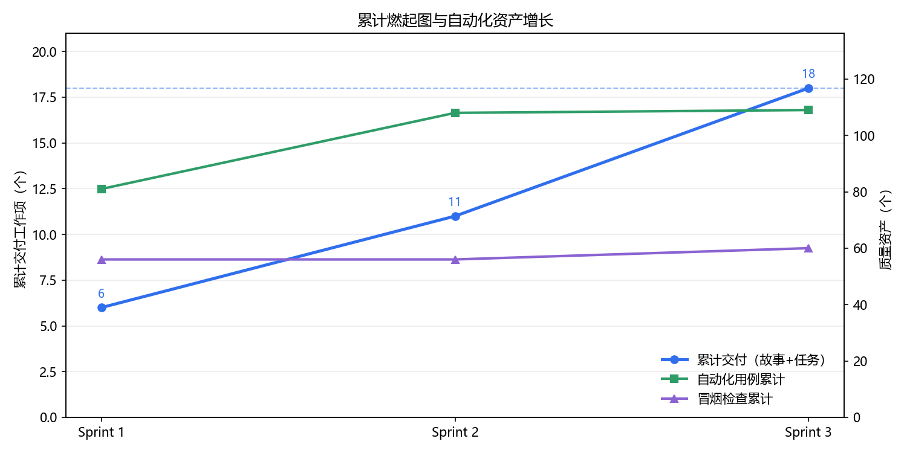

# T-07 项目级度量与复盘数据

> 责任人：刘鹏杰（质量与集成 / T-07）
> 数据日期：2026-10-24
> 用途：作为 `16组_Sprint3分工规划.md` 表 7（项目总复盘）与表 9（团队自评）的数据输入；
> 会议结论、签字与自评等级由 DRI 刘润七在评审会上确认后写入正式纪要，本文件不代替会议签字。
> 口径说明：本轮未对每人每任务做秒级工时埋点，`实际工作量` 采用“交付物 + 证据 + 检查点”
> 口径；未记录的耗时明确标注“未单列”，不事后编造。

## 1. 三轮速率与交付

| 指标 | Sprint 1 | Sprint 2 | Sprint 3 | 证据 |
| --- | --- | --- | --- | --- |
| 产品故事（达 DoD） | 6 条 Must（US-01—US-06） | 4 条（US-07—US-10） | 1 条（US-11） | 各 Sprint 分工规划 |
| 技术/发布任务 | 0 | 1（T-01 CI/回归基线） | 6（T-02—T-07） | 表 4 |
| 自动化用例（累计） | 81 | 108 | 109 | `regression/`、`t02-jdk17-test.log` |
| 真实 MySQL 冒烟 | 56 | 56 | 60（56+4） | `smoke/smoke-test-after-us11.log` |
| 计划容量 | 180 分钟（模拟 Sprint） | 175 人·分钟 / 容量 200 | 160 人·分钟 / 容量 200 | 各 Sprint 表 4 |
| 缓冲 | 未单列 | 25 人·分钟 | 40 人·分钟 | 各 Sprint 计划会纪要 |
| 实际交付 | 6/6 故事；81 用例、56 冒烟全绿 | 4/4 故事 + T-01；108 用例全绿 | US-11 + T-02/T-04/T-05/T-07 完成；T-03 权限/异常完成、主旅程待余润东；T-06 清单/Tag 待 DRI | 本目录证据 |
| 实际工作量 | 未单列 | 未单列 | 未单列 | 未做秒级埋点 |

> 口径修正：计划文字写“1 条产品增量 + 5 个发布任务包”，表 4 实际列出 T-02—T-07 共 **6** 个任务包；
> 本表按表 4 的 6 个任务计。若把 T-06/T-07 合并为“发布收尾包”，则为 5 个包，两种口径不影响总量 160 人·分钟。

### 1.1 三轮吞吐图

### 1.2 累计燃起图

累计交付工作项（故事 + 技术/发布任务）：**6 → 11 → 18**；
自动化用例资产：**81 → 108 → 109**；真实 MySQL 冒烟：**56 → 56 → 60**。
Sprint 3 的增量以“发布门禁任务”为主，产品故事只有 US-11 一条，符合本轮“发布就绪优先”的范围收敛。

## 2. 技术债总台账与结转

| 编号 | 技术债 | 本轮决定 | 影响 | 发布前证据 | 责任人 | 偿还计划 |
| --- | --- | --- | --- | --- | --- | --- |
| TD-01 | 排课未结构化落库、无冲突检测 | 降级 + 带债 | 仅展示 `schedule_info` 文本，系统不发现冲突 | `#/schedule` 只读页与截图 | 杨继鑫 | 进阶 2 建时间片/教室模型后实现冲突规则 |
| TD-02 | 评教趋势实时聚合（无汇总表） | 降级 + 带债发布 | 数据量增长后趋势查询变慢，结果仍正确 | 现有 6 个 `idx_eval_*` 索引 | 余润东 | 数据量增长后评估汇总表/定时聚合 |
| TD-03 | 冒烟依赖本地真实 MySQL | 带债发布 | 无 MySQL 的 CI 环境不能自动跑冒烟 | 60 项真实 MySQL 冒烟日志 | 刘鹏杰 | 引入 Docker/Testcontainers，把冒烟纳入 CI |
| TD-04 | 前端图表代码重复 | 清偿 | 残余重复为轻微级 | `AJ.Charts` 复用说明 | 杨继鑫 | 已完成；残余项顺手收敛 |
| TD-05 | API 契约手工维护 | 带债发布 | 契约可能随代码漂移 | `docs/API契约.md` 与实现核对 | 杨继鑫 | 发布后引入 springdoc/OpenAPI |
| **BUG-S3-01** | 合上教学班详情鉴权未覆盖 `offering_teacher` | **新登记，待修复** | 合上教师列表可见但详情 403；不影响 US-11 只读总览 | `journey/permission-anomaly-journey.md` P-03b | 杨继鑫（Sprint 4） | Sprint 4 修复 `assertOfferingAccessible` 并补回归用例 |

> 结论：本轮没有“影响正确性/安全性的技术债被无说明带病发布”。
> BUG-S3-01 是权限一致性问题，已登记为一般缺陷；是否进入发布范围由 DRI 在评审会确认。

## 3. 改进措施闭环追踪

| 措施（提出轮次） | Sprint 2 落实 | Sprint 3 最终状态 | 证据 | 结论 |
| --- | --- | --- | --- | --- |
| 固化数据字典与权限矩阵（S1） | 部分落实 | 本轮未改表、未新增权限码；US-11 复用 `offering:read` | `docs/API契约.md`、`database/数据字典.md`、US-11 契约测试 | 成习惯 |
| 接口契约先行（S1） | 已落实 | US-11 先补契约与字段清单，再实现页面/测试 | `docs/API契约.md` 第 9 节、`OfferingAndDataIT#offeringScheduleOverview` | 成习惯 |
| 开发全程同步取证（S1） | 部分落实 | 回归/冒烟/权限/异常证据实时归档；主旅程截图仍待余润东 | `docs/evidence/sprint3/**` | 部分落实 |
| CI 门禁前移（S2） | 已落实（workflow 已建） | 本地等价流水线 109 测试 + 前端 JS 检查通过；云端 Actions 未运行 | `t02-local-ci.log`、`docs/CI说明.md` | 部分落实（不得声称云端 CI 通过） |
| 集成点—回归用例映射（S2） | 已落实 | 109 自动化 + 60 冒烟 + 8 个页面旅程场景；发现 BUG-S3-01 | `regression/`、`smoke/`、`journey/ui-journey-evidence.md` | 成习惯 |
| AI 记录与证据闭会前双人核对（S2） | 部分落实 | 证据目录完整；表 5 AI 记录仍待刘润七在会前补齐 | `16组_Sprint3分工规划.md` 表 5 | 部分落实 |

## 4. Release Checklist 数据快照（供刘润七签字）

| # | 检查项 | 当前状态 | 依据 / 待办 |
| --- | --- | --- | --- |
| 1 | 全量集成构建（JDK 17） | 通过 | 109 测试 `BUILD SUCCESS` |
| 2 | 全量回归测试 | 通过 | 109/109（JDK 17） |
| 3 | 端到端主旅程 | 待补 | 主旅程截图/录屏由余润东负责 |
| 4 | 端到端异常/权限旅程 | 通过 | 8 个页面场景 + 接口证据 |
| 5 | 关键技术债清偿 | 通过 | TD-04 已清偿 |
| 6 | 结转技术债 | 通过 | TD-01/02/03/05 已登记理由与偿还计划 |
| 7 | 部署/演示环境 | 通过 | JDK 17.0.19 + MySQL 8.0.45 可复现 |
| 8 | CI 流水线 | 部分 | 本地等价通过；云端未运行 |
| 9 | 发布说明 | 通过 | `docs/发布说明.md` |
| 10 | 用户文档 | 通过 | `docs/用户手册.md`、`README.md` |
| 11 | 演示数据/账户 | 通过 | 6 账号、16 表、覆盖率 66.7% |
| 12 | 代码与资产归档 | 待办 | Release Tag `v1.0.0-sprint3` 待 DRI 打 |

## 5. 表 7 / 表 9 建议输入（供 DRI 审定）

### 5.1 表 7 Keep / Stop / Start 建议

- **Keep**：契约先行；发布门槛前置；权限/越权红线回归；证据与代码同提交；每 15 分钟检查点。
- **Stop**：最后才补证据；用本机环境结果替代发布基线；把演示当发布；让 AI 代替人工签字。
- **Start**：云端 CI 与冒烟容器化；页面旅程截图自动化（本轮已落地 Playwright 脚本）；缺陷登记后明确 Sprint 4 责任人与期限。

### 5.2 表 9 五维自评数据点

| 维度 | 可用数据点 | 不足 / 风险 |
| --- | --- | --- |
| 范围 | US-11 只读 + T-02—T-07；冲突检测等明确顺延；发布边界写入文档 | 计划文字“5 个任务包”与表 4 的 6 项存在口径差，需在纪要中统一 |
| 进度 | 三轮交付 6/4/1 条故事 + 任务包；109 测试、60 冒烟；计划 160/容量 200 | 实际工时未埋点，速率以交付物计 |
| 团队与 AI | 第 4 任 DRI；AI 参与编码、测试、审查、文档；发布决策由人把关 | 表 5 AI 记录待补齐 |
| 质量 | 109/109 + 60/60 + 8/8 页面场景；TD-04 清偿 | BUG-S3-01 待修；主旅程 E2E 待补 |
| 风险 | 环境端口冲突已用 `SMOKE_BASE_URL` 规避；带债项有台账 | 云端 CI 未运行；Release Checklist/Tag 待 DRI |

## 6. 数据来源

- 回归：`docs/evidence/sprint3/regression/jdk17-mvn-test-after-us11.log`（109/109）
- 冒烟：`docs/evidence/sprint3/smoke/smoke-test-after-us11.log`（60/60）
- 权限/异常接口：`docs/evidence/sprint3/journey/permission-anomaly-journey.md`
- 页面旅程：`docs/evidence/sprint3/journey/ui-journey-evidence.md`
- 技术债：`docs/技术债台账.md`
- 计划与容量：`16组_Sprint1分工规划.md`、`16组_Sprint2分工规划.md`、`16组_Sprint3分工规划.md`
- 图表生成脚本：`docs/evidence/sprint3/metrics/make_metrics_charts.py`
